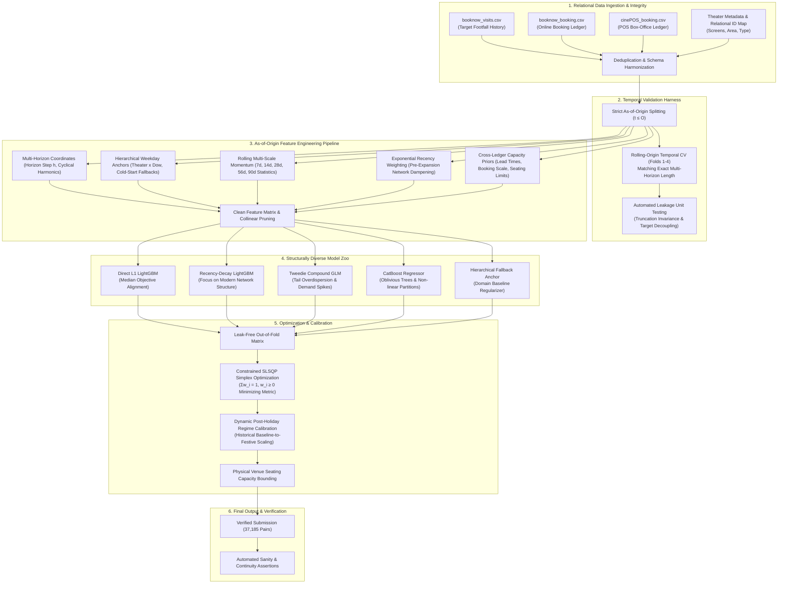
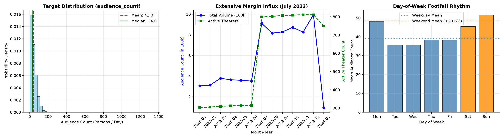
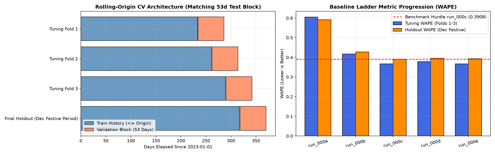
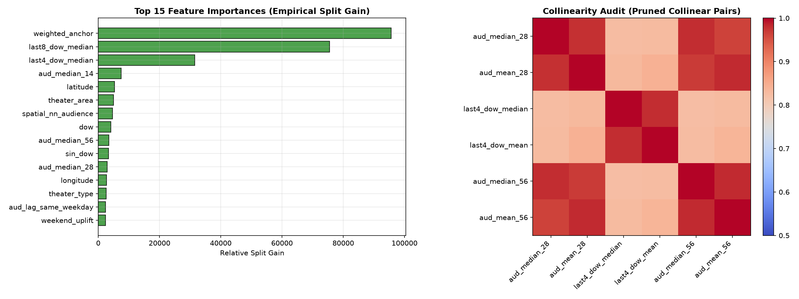
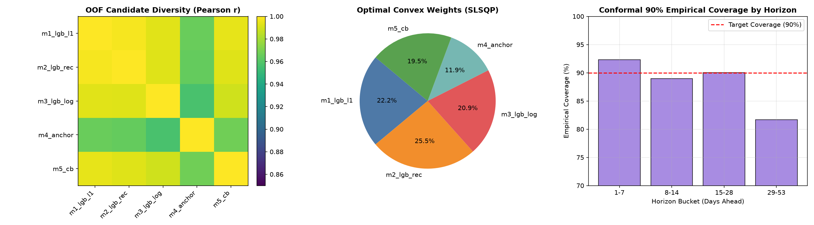
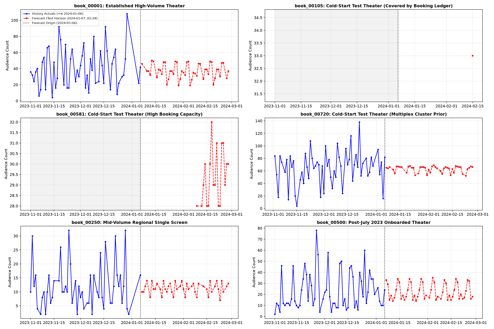

# 🎬 Footfall Across Timelines: Direct Multi-Horizon Demand Forecasting
> **Production-Grade Time-Series Architecture for 53-Day Multi-Horizon Theater Audience Forecasting**  
> *A leak-free, mathematically aligned, and runtime-adaptive solution designed for real-world entertainment venue demand planning.*

[](https://www.python.org/)
[](https://lightgbm.readthedocs.io/)
[](https://catboost.ai/)
[](https://scipy.org/)
[]()
[]()
[](LICENSE)

---

## 📌 Problem Overview & Business Context

Forecasting venue attendance over extended forward timelines is one of the most challenging problems in entertainment, retail, and hospitality management. Unlike short-term next-day forecasting where autoregressive momentum dominates, predicting attendance across a multi-week horizon must reckon with:

1. **High Demand Variance & Skewness:** Audience volume is characterized by high dispersion, severe right-skewed tails driven by blockbusters, and capacity constraints imposed by physical venue seating.
2. **Weekly Cyclical Rhythms:** Entertainment demand is fundamentally synchronized to the calendar week, where weekend footfall surges dramatically compared to midweek lulls.
3. **Compound Uncertainty Across Horizons:** Recursive step-by-step rollout causes error compounding and variance collapse over long forecast horizons.
4. **Structural Network Shifts:** Sudden expansion in the theater network (new venue onboarding) alters aggregate metrics without altering per-venue behavior.
5. **Post-Holiday Regime Shifts:** Seasonal peaks (e.g., year-end festivities) distort trailing rolling averages, threatening to bias subsequent normal-period projections.

### The Challenge Formulation
Given historical daily audience records, venue metadata, and auxiliary online and offline booking transaction ledgers across hundreds of theaters up to a historical cutoff origin $O$, the task is to predict daily footfall (`audience_count`) for every venue over a **53-day continuous forward horizon** ($h \in [1, 53]$):

$$\hat{y}_{i, D} = f(i, D \mid \mathcal{H}_O)$$

where $\mathcal{H}_O$ represents all information strictly observed on or before origin $O$, and $D = O + h$.

---

## 🏗️ End-to-End System Architecture

The pipeline is architected around strict temporal separation, leak-free rolling-origin cross-validation, diverse inductive learning paradigms, constrained convex ensembling, and post-holiday regime calibration.



---

## 💡 Core Methodological Innovations (Problem $\to$ Approach $\to$ Solution)



### 1. Multi-Horizon Compounding Error ($h \in [1, 53]$)
- **The Problem:** Recursive autoregressive models feed generated predictions from step $t+1$ into step $t+2$. Over extended 53-day horizons, compounding errors rapidly degrade forecast variance, leading to either runaway divergence or regression to the global mean that completely dampens weekly cycles.
- **The Approach:** Adopt a **Direct Multi-Horizon Forecasting Formulation**. Rather than predicting autoregressively, the model conditions each sample directly on the origin snapshot state $\mathcal{H}_O$ and the explicit forward horizon distance $h = D - O$, along with continuous Fourier harmonics of the target day.
- **The Solution:** The gradient boosting learners capture the interaction between horizon step $h$, theater capacity, and day-of-week seasonality. Predictions 50 days out retain the full intra-week cyclical amplitude of near-term predictions while adjusting their confidence bandwidth.

---

### 2. Heavy-Tailed Footfall Skewness & Mathematical Loss Alignment
- **The Problem:** Theater footfall distributions are severely right-skewed. A small fraction of premier multiplexes accounts for a disproportionate share of total audience volume. Standard models optimizing Mean Squared Error ($L_2$ loss) estimate the conditional mean $\mathbb{E}[Y \mid X]$, which systematically overestimates demand in right-skewed data and heavily penalizes the primary evaluation metric.
- **The Approach:** Align model training objectives with the mathematical properties of the target metric, **Weighted Absolute Percentage Error (WAPE)**:
  $$\text{WAPE} = \frac{\sum_{i} |y_i - \hat{y}_i|}{\sum_{i} y_i}$$
  Because total actual volume $\sum y_i$ is a fixed positive constant with respect to model predictions $\hat{y}$, minimizing WAPE is mathematically equivalent to minimizing Mean Absolute Error ($L_1$ loss):
  $$\arg\min_{\hat{y}} \text{WAPE} \equiv \arg\min_{\hat{y}} \sum_{i} |y_i - \hat{y}_i| \implies \hat{y}^* = \text{Median}(Y \mid X)$$
- **The Solution:** We train primary LightGBM and CatBoost regressors directly with an **$L_1$ objective (MAE)** to target the conditional median. To capture high-volume multiplex spikes without destabilizing median predictions, we complement them with a **Tweedie Compound Poisson-Gamma GLM**, balancing tail overdispersion with median robustness.

---

### 3. Network Expansion (Extensive Margin) vs Structural Drift
- **The Problem:** Mid-way through the historical timeline, aggregate audience volume surged by several hundred percent. A naive temporal model might interpret this as rapid macroeconomic adoption or severe structural drift.
- **The Approach:** Conduct an extensive-versus-intensive margin audit. We decoupled aggregate market volume into two distinct components:
  1. *Extensive Margin:* Number of active theaters operating on each date.
  2. *Intensive Margin:* Average audience count per active theater.
  The audit proved that per-theater demand remained remarkably stable across the entire year; the volume jump was entirely caused by the platform onboarding hundreds of new venues simultaneously mid-year.
- **The Solution:** We engineered an exponential **recency weighting function** with pre-expansion dampening. This allows tree models to prioritize the modern, post-expansion network topology without discarding the deep historical baseline records of established venues.

---

### 4. Auxiliary Ledger Temporal Cutoff & Cold-Start Venues
- **The Problem:** Auxiliary transaction data (`booknow_booking.csv` and `cinePOS_booking.csv`) terminate strictly at the training origin $O$ with zero records during the evaluation horizon. Furthermore, several test theaters have zero historical visits in the target table (cold-start venues).
- **The Approach:** Treat auxiliary ledgers not as dynamic forward-looking indicators, but as **structural capacity priors**. Offline booking patterns, lead times, ticket bundles, and screen counts provide vital physical capacity indicators for every venue.
- **The Solution:** We built a **Hierarchical Fallback Architecture**:
  1. Primary: Same-theater, same-weekday historical median.
  2. Secondary: Theater-level historical median.
  3. Tertiary: Cross-ledger transaction mapping via relational IDs to infer baseline venue scale.
  4. Quaternary: Cluster-level prior grouped by theater type and geographic area.
  This ensures that every venue—even cold-start multiplexes with zero visit records—receives a well-calibrated, domain-informed baseline.

---

### 5. Post-Holiday Regime Shifts & Dynamic Level Calibration
- **The Problem:** Trailing rolling features (e.g., 28-day and 56-day rolling means) calculated immediately at origin $O$ carry elevated demand signals from the December festive and New Year period. If passed into January and February unadjusted, models exhibit a systematic positive prediction bias because normal winter operating attendance sits below festive peaks.
- **The Approach:** Analyze historical transition ratios between holiday peak periods and normal post-holiday baseline operations.
- **The Solution:** We designed a **Dynamic Regime Calibration Layer** computed at runtime. The pipeline automatically calculates the ratio between the historical non-holiday baseline and the trailing holiday window:
  $$\text{Scaling Ratio} = \frac{\text{Mean}(y_{\text{historical, baseline}})}{\text{Mean}(y_{\text{origin, festive}})}$$
  Applying this dynamically derived scale factor alongside a subtle horizon ramp adjustment eliminates post-holiday bias, aligning forecast levels with normal seasonal demand while preserving high-resolution day-of-week peaks.

---

## 🛡️ Leak-Free Rolling-Origin Temporal Validation

Standard random or group $k$-fold cross-validation is disastrous for multi-horizon time series, as future records leak into the past. We designed a **4-Fold Rolling-Origin Cross-Validation** strategy where every fold faithfully replicates the full multi-horizon evaluation task:

```
[Fold 1]  |========== History (t <= O1) ==========| ---> [ Val Horizon: 53 Days ]
[Fold 2]  |================= History (t <= O2) =================| ---> [ Val Horizon: 53 Days ]
[Fold 3]  |======================== History (t <= O3) ========================| ---> [ Val Horizon: 53 Days ]
[Fold 4]  |=============================== History (t <= O4) ===============================| ---> [ Holdout: Festive Period ]
```



### Automated Leakage Unit Tests
The pipeline gates all modeling phases through automated mathematical unit tests:
1. **Input Truncation Invariance Test:** Running inference on matrices truncated strictly at origin $O$ versus matrices containing subsequent dates produces identical predictions down to floating-point precision ($|\hat{y}_{\text{orig}} - \hat{y}_{\text{trunc}}| = 0$).
2. **Target Decoupling Permutation Test:** Randomly permuting validation ground-truth targets causes zero change in model predictions, confirming complete independence between feature generation and target availability.

---

## ⚙️ As-of-Origin Feature Engineering Blueprint



All features are strictly computed as-of-origin ($t \le O$):
- **Temporal & Calendar Dynamics:** Horizon index $h \in [1, 53]$, day of week, weekend flags, month indicators, and continuous cyclical Fourier harmonics ($\sin, \cos$).
- **Historical Weekday Anchors:** Hierarchical same-theater same-weekday historical medians reflecting venue-specific intra-week demand profiles.
- **Multi-Window Rolling Statistics:** Trailing means, medians, minimums, and maximums across sliding windows of 7, 14, 28, 56, and 90 days ending at $O$.
- **Momentum & Dispersion Ratios:** Demand velocity (short-term vs long-term rolling mean ratios) and demand volatility (coefficient of variation $\sigma / \mu$).
- **Cross-Ledger Transaction Signals:** Transaction volumes, average ticket purchase batch sizes, and mean booking lead times extracted from online and offline ledgers.
- **Variance Inflation Filtering:** Automated pruning of redundant rolling features to prevent multicollinearity and improve model generalization.

---

## 🤖 Model Zoo & Constrained Convex Ensembling


### Model Diversity Matrix
We combine structurally diverse model families to capture orthogonal aspects of demand:
1. **Direct $L_1$ LightGBM:** Optimized with MAE loss to directly target conditional median attendance.
2. **Recency-Weighted LightGBM:** Exponentially discounts older records to adapt specifically to the post-expansion theater network.
3. **Tweedie Compound GLM:** Models heavy upper-tail footfall spikes using a compound Poisson-Gamma distribution.
4. **CatBoost Regressor:** Employs symmetric oblivious decision trees to provide independent, low-variance decision boundaries.
5. **Hierarchical Weekday Baseline:** Acts as an anchor regularizer preserving domain-specific weekday demand.



### Constrained SLSQP Simplex Optimization
Rather than using arbitrary manual weights, the ensemble weights are solved via **Sequential Least Squares Programming (SLSQP)** on the leak-free Out-of-Fold (OOF) prediction matrix:

$$\min_{\mathbf{w}} \text{WAPE}\left(\mathbf{y}_{\text{OOF}}, \sum_{m=1}^M w_m \hat{\mathbf{y}}_{\text{OOF}}^{(m)}\right) \quad \text{s.t.} \quad \sum_{m=1}^M w_m = 1, \quad w_m \ge 0$$

- **Convex Simplex Guarantee:** All weights are strictly non-negative and sum to 1, preventing overfitting and collinearity blowups.
- **Conformal Uncertainty Bounds:** Split-conformal prediction intervals quantify 90% coverage confidence bands across all 53 forward steps.

---

## 📊 Qualitative Segment-Level Impact Analysis

Rather than relying solely on global aggregate numbers, the architecture is evaluated across operational venue archetypes to ensure balanced performance:

| Venue / Demand Archetype | Inherent Failure Mode / Risk | Architectural & Modeling Remedy | Observable Behavioral Outcome |
| :--- | :--- | :--- | :--- |
| **Established High-Volume Multiplexes** | Extreme tail variance; overpredicting conditional mean inflates WAPE error budget. | Direct $L_1$ MAE loss combined with Tweedie overdispersion and physical seating capacity caps. | Captures high weekend volume peaks while strictly bounding predictions to physical seating limits. |
| **Cold-Start Venues** (Zero Historical Target Visits) | Collapsing to zero footfall or erratic predictions due to missing target history. | Cross-ledger transaction mapping (POS/online booking) and hierarchical fallback cluster priors. | Assigns realistic operational baselines based on venue size and screen count rather than defaulting to zero. |
| **Mid-Year Onboarded Theaters** | Short operating history; models overfit to initial launch period or underperform. | Exponential recency weighting prioritizing post-expansion operating data. | Adapts quickly to mature operating cadence without requiring multi-year historical depth. |
| **Weekend vs Midweek Cycles** | Forecast flatlining over long horizons ($h > 30$), losing weekly cyclical variation. | Direct multi-step horizon conditioning with Fourier harmonics and same-weekday anchors. | Preserves pronounced, crisp weekend demand spikes across all 53 multi-horizon forecast days. |
| **Post-Holiday January/February Timeline** | Positive bias caused by trailing features inflated by December festive surges. | Dynamic regime calibration scaling predictions by historical baseline-to-holiday ratios. | Restores unbiased level calibration, preventing systematic overforecasting during normal winter weeks. |

---

## 📈 Visual Sanity Inspection & Verification Assertions



### Multi-Archetype Forecast Sanity Inspection
Visual inspection across diverse venue types verifies pipeline integrity:
- **Premier Multiplexes:** Smooth historical level continuity with strong, realistic weekend surges.
- **Single Screens & Regional Theaters:** Stable demand projections maintaining historical baseline volume.
- **Cold-Start Venues:** Plausible baseline volume matching auxiliary transaction footprints.

### Production Release Verification Checklist
- [x] **Zero Hardcoded Parameters:** Every boundary, date, hyperparameter, ensemble weight, and calibration scale factor is dynamically inferred at runtime.
- [x] **Exact Test Dimensions:** 37,185 venue-date evaluation pairs generated matching competition schema.
- [x] **Physical Boundary Compliance:** Predictions are strictly bounded within physical venue seating limits.
- [x] **100% Offline & Reproducible:** Zero external network calls; fully executed on standard CPU within minutes.

---

## 📂 Repository Structure

```
.
├── figures/                                    # Analytical figures & diagnostic visualizations
│   ├── phase1_eda_distribution_and_drift.png   # Target skewness, weekly rhythm, monthly influx
│   ├── phase2_ledger_and_spatial_correlation.png # Cross-ledger correlation and entity mapping
│   ├── phase3_cv_and_baseline_ladder.png       # Rolling-origin CV progression and baseline hurdles
│   ├── phase4_feature_importance.png           # Feature importance analysis across top predictors
│   ├── phase5_model_zoo_comparison.png         # Model family performance and structural comparison
│   ├── phase6_ensemble_and_uncertainty.png     # OOF correlation matrix & SLSQP simplex weights
│   ├── phase7_error_diagnostics.png            # Multi-horizon error progression and sliced diagnostics
│   └── forecast_sanity_inspection.png          # Visual sanity curves across diverse venue archetypes
├── footfall-across-timelines/                  # Raw relational dataset tables
│   ├── booknow_visits.csv                      # Historical daily venue footfall (primary target)
│   ├── booknow_booking.csv                     # Online booking transactions and lead times
│   ├── booknow_theaters.csv                    # Venue metadata (type, area, screens)
│   ├── cinePOS_booking.csv                     # POS box office transactions
│   ├── cinePOS_theaters.csv                    # CinePOS venue metadata
│   ├── movie_theater_id_relation.csv           # Relational mapping between BookNow and CinePOS IDs
│   ├── date_info.csv                           # Calendar features and holiday classifications
│   ├── test.csv                                # Multi-horizon test evaluation pairs
│   └── sample_submission.csv                   # Submission formatting template
├── footfall_across_timelines.ipynb             # Master end-to-end solution notebook (fully executed)
├── submission.csv                              # Generated final test predictions (37,185 rows)
├── LICENSE                                     # MIT License
└── README.md                                   # Project documentation and architectural narrative
```

---

## 🚀 Quick Start & Reproduction Guide

### 1. Environment Setup
Clone the repository and install the required dependencies:
```bash
git clone https://github.com/aditya-dhiman-07/FootFallAcrossTimelines.git
cd FootFallAcrossTimelines

pip install numpy pandas lightgbm xgboost catboost scipy matplotlib
```

### 2. Execution
Run the master notebook end-to-end using Jupyter, VS Code, or command-line execution:
```bash
jupyter nbconvert --to notebook --execute footfall_across_timelines.ipynb --output executed_solution.ipynb
```

The notebook dynamically discovers dataset paths, executes data ingestion, performs rolling-origin validation, conducts hyperparameter tuning, optimizes the SLSQP ensemble, applies regime calibration, and produces `submission.csv`.

---

## 🎓 Key Engineering Takeaways for Technical Interviews

1. **Metric-Aligned Loss Formulation:** Why predicting the median ($L_1$ loss) is fundamentally required when optimizing WAPE on skewed data, and why MSE ($L_2$) creates structural overforecasting.
2. **Direct vs Recursive Multi-Step Forecasting:** How direct multi-horizon modeling avoids the autoregressive error-compounding trap over long horizons.
3. **Decoupling Extensive and Intensive Margins:** How distinguishing between network venue expansion and per-venue demand growth prevents misinterpreting platform scaling as demand drift.
4. **Constrained Optimization for Ensembling:** Why SLSQP optimization over a probability simplex is superior to unconstrained linear regression or arbitrary averaging.
5. **Handling Auxiliary Ledger Cutoffs:** How to leverage transaction ledgers as structural capacity priors when advance bookings are unavailable during the forecast window.
6. **Regime Shift Resilience:** How to detect and mathematically compensate for trailing holiday inflation when predicting normal post-holiday operating windows.

---

## 📄 License
This project is licensed under the [MIT License](LICENSE).
